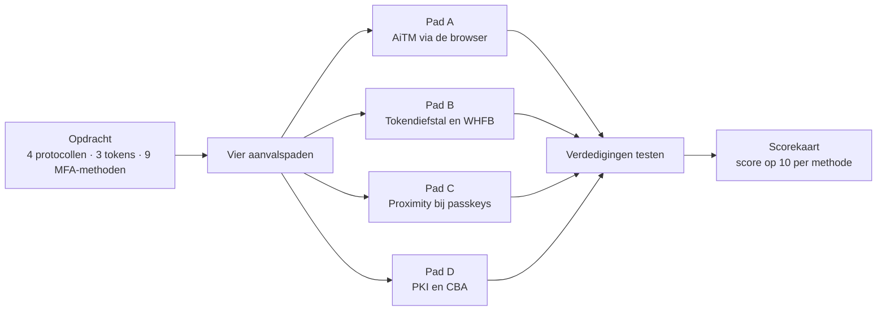

# Home

**AUTHN/AUTHZ beveiligd met MFA breken** — Applied Security Project, Bachelor Cybersecurity & Cloud, AP Hogeschool Antwerpen. Groep MFA4.
{: .fs-5 }

We onderzoeken hoe goed Microsoft Entra ID standhoudt wanneer MFA aanstaat. De rode draad: **MFA wordt omzeild, niet gekraakt.** Een aanvaller bemachtigt het token dat na een geslaagde aanmelding overblijft, en heeft de MFA-stap dan niet meer nodig.

## Het project in één beeld

## Waar vind ik wat?

| Ik wil... | Ga naar |
|---|---|
| weten wat de opdracht is en hoe we werken | [Project]({{ '/project/' | relative_url }}) |
| de achtergrond begrijpen | [Theorie]({{ '/theorie/' | relative_url }}) |
| de omgeving nabouwen | [Lab]({{ '/lab/' | relative_url }}) |
| zien wat elk pad onderzoekt en oplevert | [De vier paden]({{ '/paden/' | relative_url }}) |
| een aanval of test stap voor stap uitvoeren | [Playbooks]({{ '/playbooks/' | relative_url }}) |
| weten wat welke aanval tegenhoudt | [Verdediging]({{ '/verdediging/' | relative_url }}) |
| de uitkomsten lezen | [Resultaten]({{ '/resultaten/' | relative_url }}) |
| een commando, bron of term opzoeken | [Naslag]({{ '/naslag/' | relative_url }}) |

## Stand van zaken

| Pad | Onderwerp | Status |
|---|---|---|
| [A]({{ '/paden/pad-a/' | relative_url }}) | AiTM tegen SMS, OTP en push | Aan te vullen |
| [B]({{ '/paden/pad-b/' | relative_url }}) | Tokendiefstal, WHFB, verdedigingen | Getest en gedocumenteerd |
| [C]({{ '/paden/pad-c/' | relative_url }}) | Passkeys, proximity, Tenbeo | Aan te vullen |
| [D]({{ '/paden/pad-d/' | relative_url }}) | ESC1 op CBA | Getest; documentatie aan te vullen |

## Belangrijkste bevindingen tot nu toe

- **Credentials alleen volstaan om een toestel in de tenant te registreren.** Met enkel het wachtwoord van een testaccount registreerden we een eigen toestel, vroegen daarvoor een Primary Refresh Token (PRT) aan en verkregen access-tokens zonder MFA (sectie 5.3).
- **TPM-binding stopt het stelen van de PRT, niet het gebruiken ervan.** Op een volledig beheerd toestel met vTPM mislukten alle methoden om de PRT-sleutels te exporteren. Via het ingebouwde TokenBroker-mechanisme (BrowserCore) kregen we toch een bruikbaar PRT-token en daarmee een Exchange Online-token (sectie 5.4).
- **Token Protection werkt, maar alleen binnen zijn voorwaarden.** De Conditional Access-policy blokkeerde hergebruik van ongebonden tokens en de BrowserCore-aanval. Ze was te omzeilen door zich niet als Windows te melden, en ze liet de PRT van een door de aanvaller geregistreerd toestel door (sectie 8.2).
- **MFA eisen bij toestelregistratie stopt de registratie-aanval,** behalve voor tokens die al vóór de policy waren uitgegeven (sectie 8.4).
- **Een WHFB-PIN van 4 cijfers is in de geteste configuratie beter beschermd dan een wachtwoord van 12 tekens.** De TPM vergrendelde na 31 foute pogingen en liet daarna één poging per 10 minuten toe; de PIN is alleen bruikbaar op het toestel zelf. Het wachtwoord werd na 10 foute pogingen in de cloud vergrendeld en is vanop afstand aan te vallen. Wel bleef het wachtwoord werken terwijl de PIN vergrendeld was (hoofdstuk 7).
- **Een vervalst certificaat telde als MFA.** Via een kwetsbare certificaattemplate (ESC1) in AD CS werd een certificaat op naam van een andere gebruiker uitgegeven, waarmee zowel on-prem als in Entra ID werd aangemeld (sectie 4.1).

## Hoe lees ik de statuslabels?

| Label | Betekenis |
|---|---|
| **Getest** | Zelf uitgevoerd in het lab; resultaat en bewijs staan op de pagina. |
| **Analyse** | Onderbouwd met theorie en bronnen, niet zelf uitgevoerd. |
| **Aan te vullen** | Het labwerk loopt nog of het resultaat is nog niet verwerkt. Deze plaatsen zijn geel gemarkeerd. |
