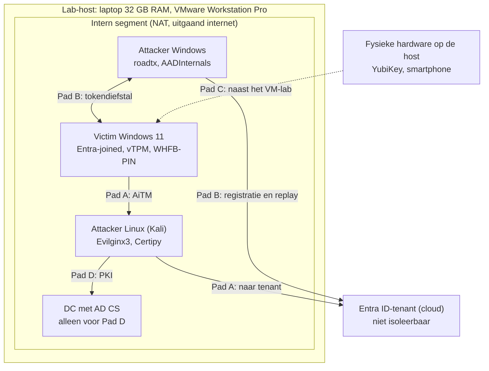

# Architectuur

Het lab draait op één laptop met 32 GB RAM en VMware Workstation Pro. De Entra ID-tenant is een clouddienst en kan niet geïsoleerd worden; isolatie betekent hier netwerksegmentatie, uitsluitend testaccounts en geen publieke blootstelling van de proxy.

| Bouwsteen | Rol | Kritische configuratie |
|---|---|---|
| Victim Windows 11 | Entra-joined toestel met vTPM en WHFB-PIN | VM-encryptie is vereist vóór een vTPM kan worden toegevoegd |
| Attacker Windows | roadtx, AADInternals, TokenTacticsV2 | PowerShell 7, Python 3.12, modules met `-Scope AllUsers` |
| Attacker Linux (Kali) | Evilginx3 als AiTM-proxy; Certipy | Phishlet voor Entra moet vóór elke demo geverifieerd worden |
| DC met AD CS | Doelwit voor Pad D | Alleen nodig voor de on-prem PKI-test |
| Fysieke hardware op de host | YubiKey, smartphone | Buiten de VM's: USB- en NFC-doorgifte naar een gast is onbetrouwbaar |
| Entra ID-tenant `aplab.be` | Identiteitsprovider, doelwit | Gedeeld; één testaccount per MFA-methode |

De paden lopen als volgt tussen de bouwstenen:

- **Pad A:** de victim-browser gaat via de proxy op Attacker Linux naar de echte Entra-aanmelding.
- **Pad B:** Attacker Windows werkt rechtstreeks tegen de tenant (toestelregistratie, token-replay); op de victim zelf draait tijdelijk AADInternals.
- **Pad C:** YubiKey en smartphone hangen aan de host.
- **Pad D:** Attacker Linux werkt tegen de DC met AD CS en daarna tegen Entra ID.

## 3.2 Licenties en toestemming

| Factor | Status |
|---|---|
| Entra ID P2 | Aanwezig via Microsoft 365 A5 for faculty/students; bevestigd door de lector |
| Intune | Beschikbaar en gebruikt voor WHFB en Defender-exclusies |
| Toestemming | Aanvallen toegestaan op eigen testaccounts met prefix `28` |
| Gedeelde tenant | Ja; elke policy is gescopeerd op eigen gebruikers of de eigen groep |

## 3.3 Testaccounts

| Account | Rol | Gebruikt in |
|---|---|---|
| `28_tu_whbf@aplab.be` | Victim: WHFB-gebruiker op het Entra-joined vTPM-toestel | BrowserCore-aanval, TPM-lockout, wachtwoordvergelijking |
| `28_tu_token@aplab.be` | Account waarvan de aanvaller het wachtwoord kent | Toestelregistratie, token-replay, verdedigingstests |

{: .todo }
> De testaccounts van Pad A, C en D (één per MFA-methode) en hun geregistreerde methode.
