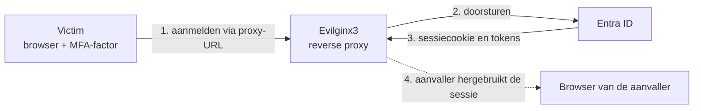

# Pad A — AiTM via de browser

| | |
|---|---|
| **Kernvraag** | Kan een deelbaar geheim of een goedkeuring onderschept worden vóór de sessie ontstaat? |
| **Dekt** | SMS, software-OTP, hardware-OTP, Authenticator-push; SAML, OIDC en OAuth als transport |
| **Opstelling** | Victim Windows 11 → Attacker Linux (Kali) met Evilginx3 → Entra ID |
| **Status** | Aan te vullen |

## Hoe de aanval werkt

Evilginx3 staat als reverse proxy tussen de browser van de victim en de echte Entra-aanmelding. De victim meldt aan, inclusief de MFA-stap. De proxy stuurt alles door en onderschept de sessiecookie en tokens die Entra ID na de geldige aanmelding teruggeeft. De aanvaller laadt die in een eigen browser.

## Wat we verwachten

Alle methoden met een deelbaar geheim of een goedkeuring zijn via dit pad aan te vallen. Passkeys niet: ze zijn cryptografisch aan het echte domein gebonden. Dat verschil is de waarde van dit pad.

Eén proxy dekt vier factoren; we wisselen alleen van testaccount.

## Aandachtspunten

- Phishlets voor Entra breken regelmatig door wijzigingen aan de aanmeldpagina. Verifieer vóór elke opname.
- Stel de proxy niet publiek bloot.
- Herhaal de aanvallen met een policy die phishing-resistente MFA afdwingt.

## Resultaten

{: .todo }
> Door de eigenaar van dit pad: per aanval de startcondities, de stappen, het resultaat (gelukt of mislukt) en het bewijs. Gebruik het [playbook-sjabloon]({{ '/playbooks/sjabloon/' | relative_url }}).

Theorie per methode: [MFA-methoden]({{ '/theorie/mfa-methoden/' | relative_url }}).
