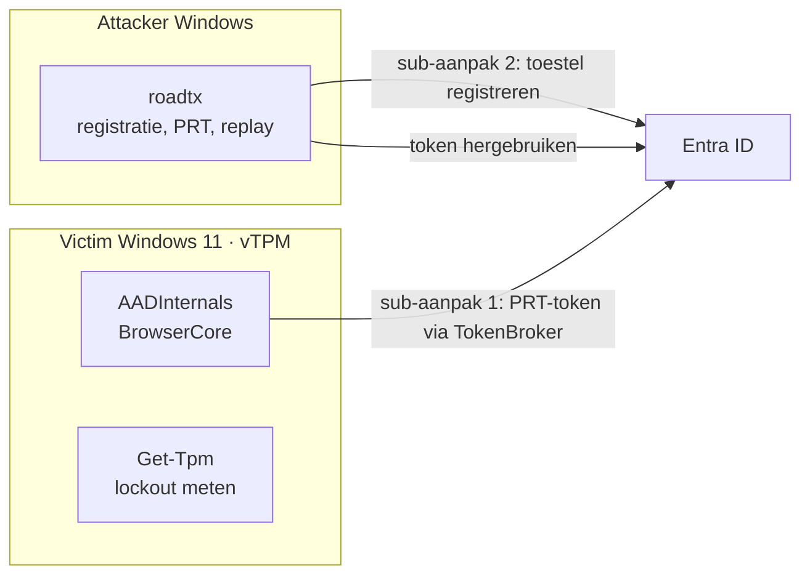

# Pad B — Tokendiefstal en WHFB

| | |
|---|---|
| **Kernvraag** | Wat kan een aanvaller met gestolen toegang of een token, en houdt binding dat tegen? |
| **Dekt** | PRT, refresh-token, access-token; WHFB; onderzoeksvraag PIN tegenover wachtwoord; verdedigingen |
| **Opstelling** | Attacker Windows (roadtx, AADInternals) en Victim Windows 11 met vTPM |
| **Status** | Getest en gedocumenteerd |

## Kernonderscheid

"PRT stelen" (de sleutels exporteren) is iets anders dan "PRT gebruiken" (een token laten uitgeven via een geautoriseerd kanaal). TPM-binding stopt het eerste, niet het tweede.

## Aanvallen en resultaten

| Playbook | Uitgangspositie | Resultaat |
|---|---|---|
| [PB-01 Toestelregistratie en PRT]({{ '/playbooks/pb-01-toestelregistratie/' | relative_url }}) | Alleen een wachtwoord | **Geslaagd** |
| [PB-02 PRT-sleutels exporteren]({{ '/playbooks/pb-02-prt-extractie/' | relative_url }}) | Lokale beheerder op beheerd toestel | **Geblokkeerd** |
| [PB-03 PRT gebruiken via BrowserCore]({{ '/playbooks/pb-03-browsercore/' | relative_url }}) | Lokale beheerder op beheerd toestel | **Geslaagd** |
| [PB-04 Refresh-token replay]({{ '/playbooks/pb-04-refresh-token-replay/' | relative_url }}) | Een geldig refresh-token | **Geslaagd** |

## Verdedigingen en resultaten

| Playbook | Resultaat |
|---|---|
| [PB-05 Token Protection]({{ '/playbooks/pb-05-token-protection/' | relative_url }}) | Blokkeert ongebonden tokens en BrowserCore; omzeilbaar via het platform; laat de PRT van een aanvallerstoestel door |
| [PB-06 Onbekende platformen blokkeren]({{ '/playbooks/pb-06-platform-policy/' | relative_url }}) | Sluit de platform-omzeiling |
| [PB-07 MFA bij toestelregistratie]({{ '/playbooks/pb-07-mfa-bij-registratie/' | relative_url }}) | Stopt de registratie, behalve met een eerder verkregen token |

## Onderzoeksvraag

| Playbook | Resultaat |
|---|---|
| [PB-08 TPM-lockout]({{ '/playbooks/pb-08-tpm-lockout/' | relative_url }}) | TPM vergrendelt na 31 foute PINs; daarna één poging per 10 minuten |
| [PB-09 Smart lockout]({{ '/playbooks/pb-09-smart-lockout/' | relative_url }}) | Account vergrendeld na 10 foute wachtwoorden |

Het antwoord staat op [PIN tegenover wachtwoord]({{ '/resultaten/onderzoeksvraag/' | relative_url }}).

## Conclusie

Een token is een toegangsbewijs dat losstaat van de manier waarop de gebruiker zich aanmeldde. Zonder binding aan een toestel is elk refresh-token overdraagbaar. Met TPM-binding is de PRT niet te stelen, maar wel te gebruiken door wie code kan uitvoeren in de sessie van de gebruiker. En wie een eigen toestel kan registreren, krijgt een PRT die volledig van hem is. Hoofdstuk 8 toont welke verdedigingen elk van deze drie gevallen tegenhouden.
