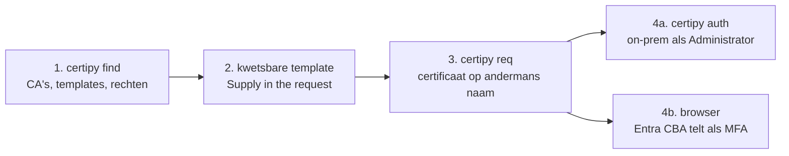

# Pad D — PKI en CBA

| | |
|---|---|
| **Kernvraag** | Is de certificaatketen zelf het zwakke punt? |
| **Dekt** | Certificate-based authentication |
| **Opstelling** | Attacker Linux (Kali) met Certipy; DC met AD CS; Entra CBA |
| **Status** | Getest; commando's en screenshots aan te vullen |

## De aanvalsketen

## Uitgevoerde aanval: ESC1

De aanval misbruikt een certificaattemplate waarin "Supply in the request" aanstaat: de aanvrager kiest dan zelf op welke naam het certificaat wordt uitgegeven.

| Stap | Wat er gebeurt |
|---|---|
| 1 | Kwetsbare template in AD CS vinden: "Supply in the request" staat aan |
| 2 | Certificaat aanvragen op een zelfgekozen naam: voor de domeinbeheerder en voor een Entra-testgebruiker |
| 3 | Aanmelden met dat certificaat: on-prem met Certipy, in de cloud via de browser |

Resultaat: geslaagd op beide fronten.

- **On-prem:** aangemeld als Administrator via LDAPS op de domain controller.
- **Cloud:** de MFA-policy is omzeild. Entra ID aanvaardde het certificaat als MFA, zonder dat de Authenticator-app nodig was.

{: .todo }
> Door de eigenaar van Pad D: de exacte Certipy-commando's (`certipy find`, `certipy req`, `certipy auth`), de configuratie van de template en van Entra CBA (telt het certificaat als één of twee factoren, welke mapping), en de screenshots.

**Waarom de aanval slaagt.** Het protocol zelf is niet gebroken. Entra ID vertrouwt elk certificaat dat door de geconfigureerde CA is uitgegeven en dat op een account past. De vraag "wie is deze gebruiker" is daardoor verschoven naar "wie mag bij deze CA een certificaat op die naam krijgen". Een fout in één template volstaat om elke gebruiker te imiteren, inclusief het MFA-bewijs.

**Verdediging.** "Supply in the request" uitschakelen of manager-goedkeuring vereisen op templates met clientauthenticatie; inschrijfrechten beperken; sterke certificaatmapping in Entra CBA (op basis van uitgever en serienummer of SKI in plaats van alleen de naam); intrekkingscontrole afdwingen; de CA monitoren als een systeem van het hoogste niveau.

Playbook: [PB-10 ESC1 op CBA]({{ '/playbooks/pb-10-esc1/' | relative_url }}). Theorie: [Protocollen]({{ '/theorie/protocollen/' | relative_url }}).
